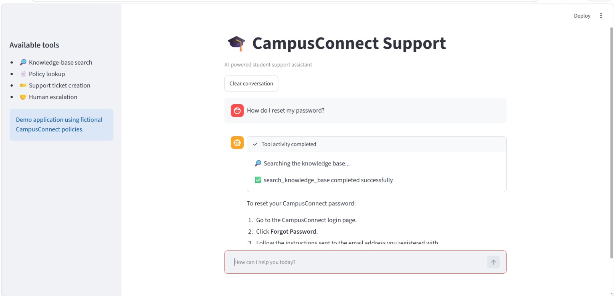
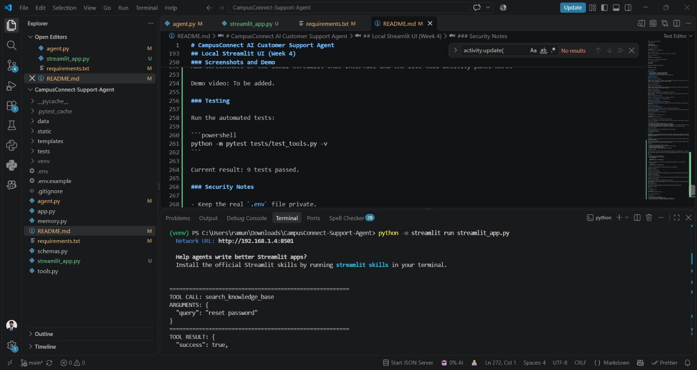

# CampusConnect AI Customer Support Agent

An AI-powered customer support chatbot built with Python, Flask, and Groq. It helps users find answers, look up policies, create support tickets, and escalate unresolved issues for human review.

## Features

- **Knowledge Base Search:** Searches documented FAQs to answer common questions.
- **Policy Lookup:** Retrieves information about refunds, payments, applications, and accounts.
- **Support Ticket Creation:** Creates tickets with a unique ID, category, priority, and status.
- **Human Escalation:** Records escalation requests for existing support tickets.
- **Conversation Memory:** Maintains context during a conversation.
- **Multi-Step Tool Use:** Allows the AI agent to coordinate multiple support tools.
- **Error Handling:** Handles invalid inputs, missing results, tool failures, and unsupported questions.
- **Web Interface:** Responsive customer support chat interface.
- **Automated Testing:** Includes tests for tool functionality and error handling.

## Technology Stack

- Python
- Flask
- Groq API using the OpenAI-compatible Python SDK
- SQLite
- HTML, CSS, and JavaScript
- pytest

## Project Structure

```text
CampusConnect-Support-Agent/
├── app.py
├── agent.py
├── tools.py
├── schemas.py
├── memory.py
├── requirements.txt
├── .env.example
├── .gitignore
├── README.md
├── templates/
│   └── index.html
├── static/
│   ├── style.css
│   └── script.js
├── data/
│   ├── knowledge_base.json
│   ├── policies.json
│   └── support.db
└── tests/
    └── test_tools.py
```

The SQLite database is created automatically when required. The database file should not be committed to Git.

## Setup and Installation

### 1. Clone the repository

```bash
git clone YOUR_GITHUB_REPOSITORY_URL
cd CampusConnect-Support-Agent
```

Replace `YOUR_GITHUB_REPOSITORY_URL` with the URL of your GitHub repository.

### 2. Create a virtual environment

Windows PowerShell:

```powershell
python -m venv venv
.\venv\Scripts\Activate.ps1
```

### 3. Install dependencies

```powershell
python -m pip install -r requirements.txt
```

### 4. Configure the API key

Create a `.env` file in the project root using `.env.example` as a template.

Add your own Groq API key:

```text
GROQ_API_KEY=your_groq_api_key_here
```

Never commit `.env` or expose your API key publicly.

### 5. Start the application

```powershell
python app.py
```

Open the following address in your browser:

```text
http://127.0.0.1:5000
```

## Available Agent Tools

| Tool | Purpose |
|---|---|
| `search_knowledge_base` | Searches documented FAQs |
| `get_policy_details` | Retrieves policy information |
| `create_support_ticket` | Creates a support ticket |
| `escalate_to_human` | Records an escalation for an existing ticket |

## Example Conversations

### Example 1: Password Reset

**User:** How do I reset my password?

**Agent:** Open the CampusConnect login page, select Forgot Password, and follow the instructions sent to your registered email address. Check your spam folder if you do not receive the email.

**Tool:** `search_knowledge_base`

### Example 2: Refund Policy

**User:** What is your refund policy?

**Agent:** Refund eligibility depends on the relevant service and transaction. A support ticket is required for an individual refund inquiry so the support team can review the details.

**Tool:** `get_policy_details`

### Example 3: Payment Discrepancy

**User:** My payment was deducted, but my application still shows unpaid.

**Agent:** Keep your transaction reference and payment confirmation. If the status remains unpaid, I can help create a support ticket for review.

**User:** Yes, please create a ticket.

**Agent:** The ticket has been created, and I can provide its ticket ID.

**Tools:** `search_knowledge_base`, `create_support_ticket`

### Example 4: Human Escalation

**User:** Please escalate my payment issue for human review.

**Agent:** The existing support ticket can be escalated for human review. The escalation is confirmed only when the escalation tool succeeds.

**Tool:** `escalate_to_human`

### Example 5: Unsupported Information

**User:** What is the guaranteed admission cutoff for a particular college this year?

**Agent:** Admission requirements and cutoffs vary by institution. Please check the institution's official website for current and authoritative information.

**Tool:** Knowledge-base search, where appropriate.

## Running Tests

Run the automated tests from the project root:

```powershell
python -m pytest tests/test_tools.py -v
```

The current development test run completed with **9 passing tests**.

The tests cover knowledge-base search, policy lookup, ticket creation, escalation, invalid inputs, and unknown ticket IDs.

## API and Security Notes

- Store API keys in environment variables and keep `.env` out of Git.
- Never request users' passwords, payment PINs, or one-time passwords.
- Do not claim that an email was sent or a human agent was notified unless the corresponding integration actually completed.
- Verify tool results before confirming ticket creation or escalation.
- The current Flask development server is intended for local demonstration, not production deployment.

## Demo and Screenshots

Add your demonstration video link and screenshots here after recording them.

- Demo video: To be added
- GitHub repository: To be added

## Disclaimer

CampusConnect is a fictional demonstration product. The FAQ content, policies, support workflows, and example conversations are provided for educational purposes. They do not represent an actual college-admission, payment-processing, refund, or customer-support service.

## Author

Developed as a real-world task agent project to demonstrate AI tool calling, customer support automation, backend development, and automated testing.
## Local Streamlit UI (Week 4)

CampusConnect Support Agent includes a local Streamlit chat interface. Users can interact with the AI assistant through a browser without needing to use the command line for each request.

### Features

- Interactive chat interface with conversation history.
- Live tool activity showing which tools are called and whether they succeed.
- Knowledge-base search and policy lookup.
- Support ticket creation and human escalation.
- Local SQLite storage for support tickets and escalation records.

### Model and Provider

The application uses the Groq API through the OpenAI-compatible Python SDK. The configured model is `openai/gpt-oss-20b`.

Groq provides hosted inference through an API, while the OpenAI-compatible interface lets the project use the familiar Python SDK.

### Setup

1. Install Python and clone the repository.
2. Create and activate a virtual environment.
3. Install dependencies:

   ```powershell
   python -m pip install -r requirements.txt
   ```

4. Create a `.env` file using `.env.example` as a template and set `GROQ_API_KEY` to your own API key.
5. Run the application:

   ```powershell
   python -m streamlit run streamlit_app.py
   ```

6. Open the local URL displayed in the terminal, usually `http://localhost:8501`.

### Example Interactions

**Example 1 — Password reset**

User: How do I reset my password?

Expected behavior: The agent searches the knowledge base and returns the documented password-reset instructions.

**Example 2 — Refund policy**

User: What is your refund policy?

Expected behavior: The agent looks up the refund policy and explains that individual refund inquiries require support review.

**Example 3 — Payment issue**

User: My payment was deducted, but my application still shows unpaid.

Expected behavior: The agent provides guidance, offers to create a support ticket, and can escalate the ticket for human review after confirmation.

### Screenshots and Demo


## Screenshots

### Chat Interface


### Live Tool Activity



Demo video: To be added.

### Testing

Run the automated tests:

```powershell
python -m pytest tests/test_tools.py -v
```

Current result: 9 tests passed.

### Security Notes

- Keep the real `.env` file private.
- Never commit API keys or local database files.
- The project uses fictional CampusConnect policies for demonstration.
- The local Streamlit server is intended for development and demonstration.
